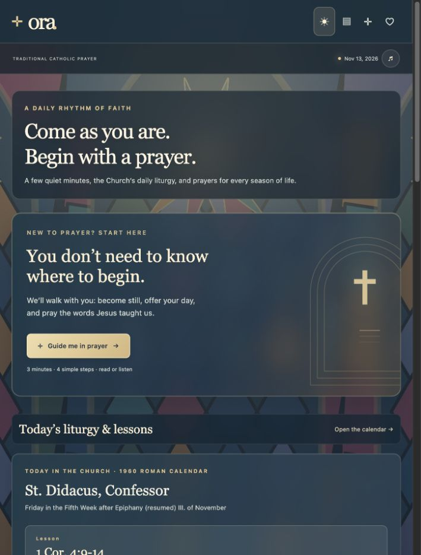
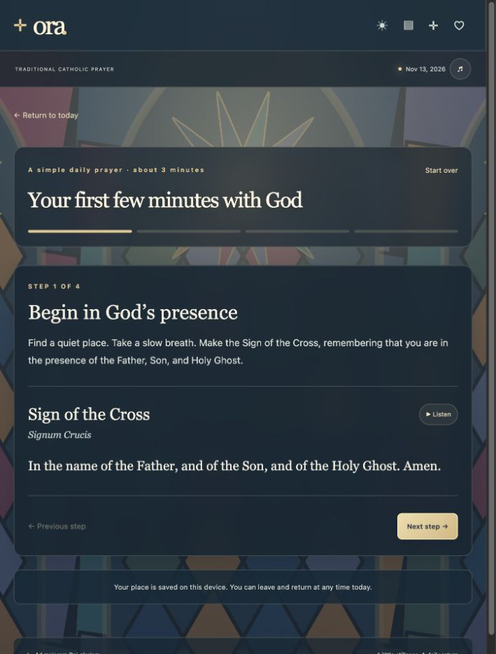
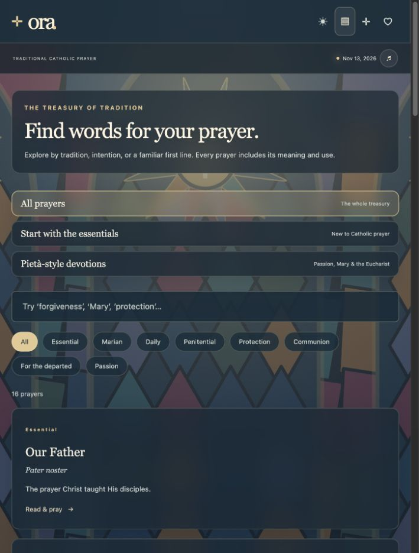
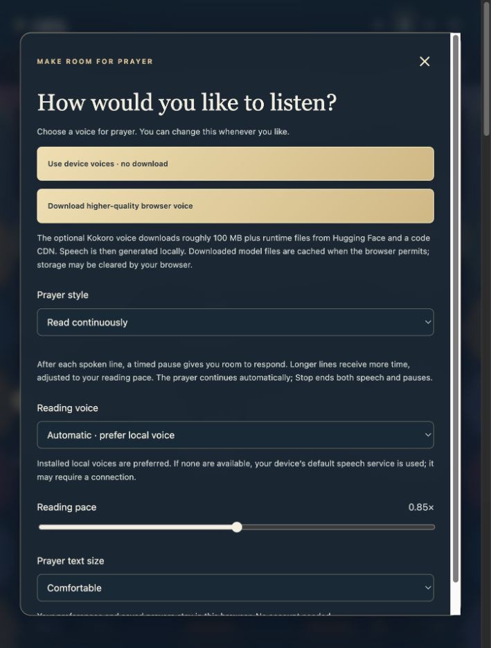
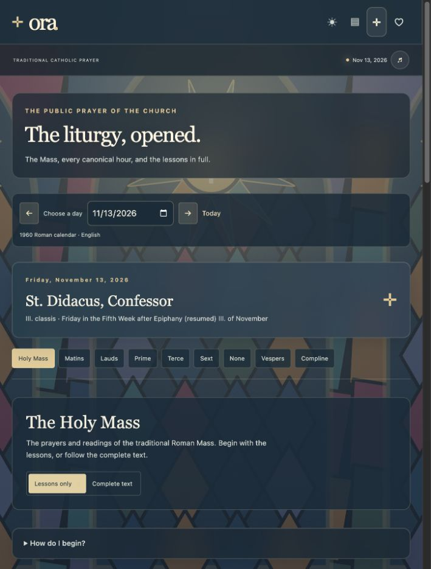

# Ora — User manual

**[Open Ora](https://awerds.github.io/prayer/)** · [Releases](https://github.com/awerds/prayer/releases) · [Security review](SECURITY.md) · [Maintenance guide](docs/MAINTAINING.md)

Ora is a traditional Catholic prayer companion with guided prayer, a searchable treasury, and the daily Mass and Divine Office. Its stained-glass background and frosted reading panels provide a quiet place to read or listen. No account is required.

## Start your first prayer

1. Open **Today** (the sun icon on a narrow screen).
2. Select **Guide me in prayer**.
3. Read the short instruction and the prayer beneath it. Use **Listen** if you prefer spoken prayer.
4. Use **Next step** to move through the four steps. **Previous step** goes back; **Start over** returns to the beginning.
5. Select **Finish prayer** on the last step to return home.

Your place is saved in this browser for the current day. Returning to Today after advancing a step shows **Continue your prayer**. Guided steps advance using their buttons; timed call-and-response is available in the separate prayer reader described below.

## Find a prayer for your day

On Today, choose an intention under **What brings you to prayer?**:

| Path | What it offers |
| --- | --- |
| I’m carrying a worry | Trust, guidance, and protection |
| I want to begin again | Gratitude, examination of conscience, and contrition |
| I want to draw closer to Jesus | Spiritual Communion and Eucharistic devotion |

The **A rhythm for your day** cards open the Morning Offering, Angelus, and Act of Contrition. The evening card is an entry into recollection, rather than the complete Office of Compline.

## Explore the prayer library

Open **Prayer library** (the book/list icon). Choose **All prayers**, **Start with the essentials**, or **Pietà-style devotions**. Then filter by category or search for a title, Latin title, phrase, intention, or meaning. Search and category filters apply within the selected collection.

Select a prayer to open its full text, **Meaning & use**, and source reference. Choose **Save** to add it to **Saved prayers** (the heart icon). Selecting **Saved** again removes it. Close the reader with **×** or Escape.

The library contains 16 private prayers. The six Pietà-style selections are the Memorare, Anima Christi, Prayer Before a Crucifix, Spiritual Communion, Saint Michael prayer, and Salve Regina. This collection is not a complete reproduction of a particular Pietà Prayer Book edition.

## Choose your voice and reading preferences

Open **Voice settings** using the music-note button near the date. On wider screens, you can also choose **Reading & voice** in the sidebar. Your first attempt to listen asks you to choose a voice source. Choose one, close settings, and press Listen again.

| Option | How it works |
| --- | --- |
| **Use device voices** | No model download. Installed English voices are preferred; the device’s default service may require internet. Choose an available voice in **Reading voice**. |
| **Download higher-quality browser voice** | Downloads the optional Kokoro model, roughly 100 MB plus runtime files. Keep the page open until it reports that the voice is ready. Speech is generated in the browser using a fixed voice. |

Use **Reading pace** to adjust speed from 0.5× to 1.2×. Choose **Comfortable**, **Large**, or **Extra large** under **Prayer text size**. The device voice selector applies to device speech, not the fixed Kokoro voice.

Browser voice files come from third-party hosting and are cached where supported. Browsers can clear that cache. A failed browser speech attempt falls back to device speech; a failed download offers a retry or device voices. Browser-model playback has not yet been verified end to end on every supported device.

## Pray with timed call and response

1. In voice settings, choose **Call and response · timed pauses** under **Prayer style**.
2. Close settings and open a prayer from the library or a daily prayer card.
3. Select **Listen to prayer**.
4. Listen to the displayed line, then repeat it or give your response during the pause. The next line starts automatically.

Longer lines receive longer pauses. Timing also follows your selected reading pace, with a minimum pause of four seconds. **Stop** cancels both speech and the pending pause; listening again restarts the prayer. Closing the reader or navigating away also stops playback.

This mode uses timed silence, not a microphone or speech recognition. It does not detect whether you have finished responding. The current mode splits the text into spoken phrases for repetition; it does not automatically assign traditional leader/congregation parts. Guided prayer steps continue to use their own Next step buttons.

Choose **Read continuously** to hear the whole text without response pauses.

## Read the liturgy and its lessons

Today shows the day’s celebration and shortcuts to its appointed Mass lesson and Gospel. Select **The liturgy** (the cross icon) to explore further.

1. Use **Choose a day**, the arrows, or **Today** to set the date.
2. Select **Holy Mass** or one of the eight canonical hours.
3. For Mass or Matins, choose **Lessons only** for focused reading or **Complete text** for the surrounding prayers and directions.
4. Use the contents links to jump to a section. **Listen** opens that section in the prayer reader.
5. Expand **How do I begin?** for introductory guidance.

The date, hour, and selected view are included in the address bar, so you can copy the URL to share that view.

| Hour | Traditional place in the day |
| --- | --- |
| Matins | Night office and longer lessons |
| Lauds | Morning praise |
| Prime | First hour and the day’s work |
| Terce | Third hour, traditionally around 9 a.m. |
| Sext | Sixth hour, around noon |
| None | Ninth hour, around 3 p.m. |
| Vespers | Evening praise |
| Compline | Prayer before rest; a useful starting point |

**Reading marks:** P. means priest; S. means server; ℣. marks a verse and ℟. a response. Psalm numbering follows the traditional source. Complete-text mode retains ceremonial directions; lessons-only mode removes selected surrounding directions and prayers for easier reading.

### Calendar and text coverage

The included calendar covers **January 1, 2026 through December 31, 2027**, using **1960 Roman rubrics** and English texts generated from [Divinum Officium](https://www.divinumofficium.com/). It includes 730 days of Mass and all eight hours, with Scripture, patristic, and saint readings.

Local diocesan or religious calendars may differ. When a day offers multiple Masses, the first is included. Alternate Christmas Masses, the modern lectionary, and the 1970 Liturgy of the Hours are not included. The [maintenance guide](docs/MAINTAINING.md) records the exact source revision and regeneration instructions; the [source license](data/liturgy/LICENSE.txt) is retained.

Private devotions and editorial guidance are distinct from official liturgical texts. Inclusion does not assert an imprimatur, indulgence, or approval of associated devotional promises.

## Offline use and saved information

Open Ora while connected before relying on it offline. The application and private prayer library are cached; each liturgical day is cached when opened. Open the dates you plan to use beforehand. The entire two-year calendar is not downloaded automatically.

Offline speech requires a working installed voice or available browser-model/runtime files. The optional download does not guarantee offline operation on every browser. Saved prayers, preferences, and guided progress stay in the current browser; they do not sync across devices. Clearing site data or using a private browsing session can remove them. No microphone access is needed.

## Troubleshooting

| Problem | What to try |
| --- | --- |
| Nothing speaks | Choose a voice source, close settings, and press Listen again. Check volume and select another device voice. |
| Browser voice download fails | Keep the tab open on a stable connection, retry, or choose device voices. |
| Response pauses feel too short | Reduce Reading pace; pauses grow with the estimated speaking time. |
| A date is unavailable | Choose a date in 2026–2027. If offline, reconnect and open that date once. |
| Search finds nothing | Switch to All prayers and reset the category to All. |
| Saved prayers disappeared | Confirm you are using the same browser and site address. Local preview and the published site have separate storage. |
| Updated content looks old | Reload while connected so the service worker can refresh the cached app. |

## Release and support

The initial release is **v1.0.0**. Screenshots above were captured from the published app on November 13, 2026; dates and the responsive layout will vary on your device. Report issues at [GitHub Issues](https://github.com/awerds/prayer/issues), including your browser, device, and steps to reproduce. Avoid including private personal information.

For local setup, validation, content updates, and Pages deployment, see the [maintenance guide](docs/MAINTAINING.md). For review findings and remaining dependency risks, see [SECURITY.md](SECURITY.md).
